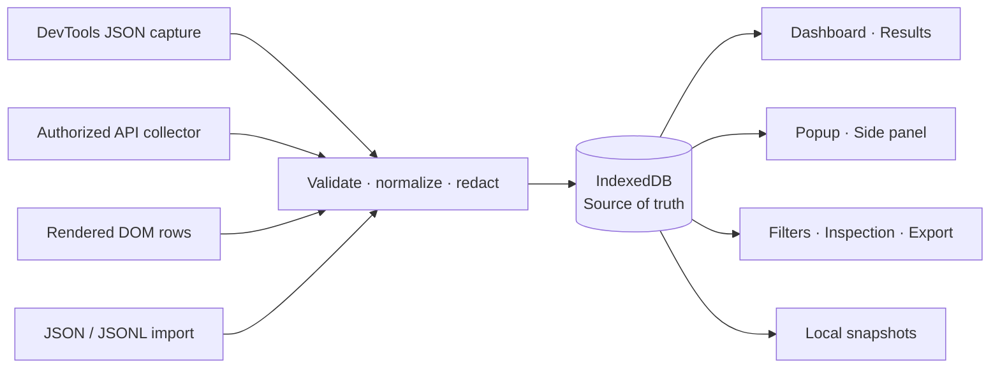

<div align="center">


# Annotation Analytics

### Collect once. Analyze locally. Stay in control.

A private, cache-first Chrome extension for turning annotation records<br>
and reviewer feedback into an inspectable analytics workspace.


[Quick start](#quick-start) &nbsp;·&nbsp;
[How it works](#how-it-works) &nbsp;·&nbsp;
[Collect reviews](#collect-linkedin-review-scores) &nbsp;·&nbsp;
[Financials](#financials--greenlight) &nbsp;·&nbsp;
[Documentation](#documentation)

</div>

---

> **Your saved data is the source of truth.** Dashboard, Results, popup and side panel read IndexedDB—not a live API. Collection starts only when you request it, saves incrementally, and never needs to finish before you can inspect the results.

## At a glance

| Collect | Understand | Keep |
|---|---|---|
| Real JSON responses through Chrome DevTools | Reviewer-score averages, distributions and trends | Persistent records with no automatic expiry |
| Authorized API pagination and rendered DOM rows | Combined filters, search and feedback inspection | CSV, JSON and JSONL exports |
| Saved JSON/JSONL responses | Separate reviewer quality and task-answer results | Local snapshots with merge, replace and compare |
| Resumable, user-started review enrichment | Transparent cache, request and completeness diagnostics | Your data on your device |
| Native Greenlight time-response capture and rendered rates | Paid/pending earnings and confirmed batch-based estimates | A separate local financial ledger |

**No backend. No AI API key. No cloud account. No telemetry.** This is an independent application, not an add-on to a browser evaluator extension.

## Quick start

### 1. Build the extension

You need **Node.js 22.13+** and npm; Node.js 24 LTS is recommended. Use **Chrome 116+**, preferably its current release.

```powershell
npm ci
npm run build
```

### 2. Load it in Chrome

1. Open `chrome://extensions` and enable **Developer mode**.
2. Choose **Load unpacked** and select this repository's **`dist`** directory.
3. Pin **Annotation Analytics** to the toolbar.
4. Open its popup on your annotation website, then choose **Open analytics dashboard**.

The extension starts empty: no demo records, invented scores or placeholder statistics.

### 3. Add your data

Open **Sources** to import a saved JSON response, capture website responses, or configure an authorized collector. The dashboard updates from saved records as they arrive.

> **Updating an existing installation?** Reload the extension at `chrome://extensions`, then close and reopen its dashboard tabs. Reopen website DevTools after changing capture code. Reloading the same installation preserves its local database; you do not need to re-enrich cached reviews.

## How it works



### A workspace, not a live API viewer

- **Read offline.** Opening an analytics view does not fetch the platform or navigate tasks.
- **Collect independently.** Review ingestion runs in a user-started, non-active extension tab. Navigate the dashboard or close the initiating popup without stopping it.
- **Save as you go.** Results, errors and queue progress persist incrementally.
- **Reuse completed work.** Verified details—including responses without a review—have no TTL. Normal collection and list re-imports do not invalidate them.
- **Refresh deliberately.** Only explicit refresh actions bypass the review cache. Failed refreshes retain the last good data.

Pause, Cancel and Resume are available from **Sources** or **Review Analytics**. Closing the collection tab or restarting Chrome interrupts the job; resumption is always explicit. Chrome can throttle background work, so pacing is a minimum, not a timing guarantee.

Snapshot **Merge** preserves richer verified details. **Replace**, **Clear current results**, or deleting extension data intentionally removes or replaces affected records—save a snapshot first.

## Choose a collection method

| Method | Best for | Important boundary |
|---|---|---|
| **DevTools capture** | JSON the website already requests | DevTools must remain open; only future completed responses are available |
| **Authenticated API** | Collecting a listing through detected pagination | Requires a compatible endpoint, authorized session and approved host access |
| **DOM collection** | Extracting explicit values from rendered task rows | Visible or virtualized rows are only a partial dataset |
| **File import** | Offline analysis and saved responses | Supports JSON/JSONL, not HAR archives |

### DevTools capture

1. On the annotation website, open DevTools with **F12** or **Ctrl+Shift+I**.
2. Select **Annotation Analytics** in its tab bar or overflow menu.
3. Click **Start capture**, then reload the website or navigate its task list.
4. Inspect recognized records and collection diagnostics in **Sources**.

Response bodies come from the documented `chrome.devtools.network.getContent()` API. The service worker cannot arbitrarily read everything in the Network panel. Request headers, cookies and request bodies are not recorded.

### Authenticated API collection

Find an actual JSON listing response in the website's Network panel. Copy its **endpoint URL only**, including existing filters and first-page query parameters.

In **Sources**, paste the endpoint, choose **Fetch all available pages / refresh**, and approve the requested host permission. The collector preserves relevant filters and follows supported, detected pagination. It limits page count, paces requests, rejects redirects/cross-origin next links and allows cancellation. Previously saved pages survive a failure.

Browser cookie policies, login rules and server restrictions still apply. POST-only GraphQL, bearer-token-only APIs, or sessions inaccessible to the extension may require DevTools capture or import instead. Never paste Cookie, Authorization or CSRF headers, “Copy as fetch,” or credential-bearing cURL commands.

For separate result endpoints and explicit identity-based joins, see [API discovery](docs/API_DISCOVERY.md).

### Import saved responses

Under **Sources → Import saved responses**, choose a JSON or JSONL file up to **50 MB**. Supported inputs include response envelopes, individual annotations, exported records and exported JSON snapshots.

For raw responses, supply the original response URL when available: it establishes the origin used for deduplication and collection eligibility. Without it, raw imports remain visible in a separate unknown-origin namespace. JSONL requires one complete JSON object per line. Save response bodies rather than HAR files, which can contain credentials.

## Collect LinkedIn review scores

The website-driven workflow lets the website handle its own authentication while the extension captures and saves the resulting review JSON.

1. **Discover the listing.** Collect authorized annotation IDs through actual pagination, capture or import. Raw imports need their original LinkedIn response URL to qualify for live enrichment.
2. **Select the website.** Open the extension popup on your signed-in **LinkedIn AI Trainer** tab.
3. **Open website DevTools.** Keep it open on that same tab.
4. **Start ingestion.** In **Sources** or **Review Analytics**, choose **Collect through website**.
5. **Use your workspace.** Inspect saved data while the non-active collection tab processes remaining IDs. Keep that tab, the website and its DevTools open.

For each discovered ID, the collector clicks an existing matching task link or opens its normal task page. The website makes its own request; DevTools captures the response, validates it and acknowledges success only after persistence. **A click alone never counts as a successful review fetch.**

Website mode uses one task at a time, at least **1,500 ms** between settled attempts, **no automatic retries**, and a **60-second** response timeout. Login navigation, unavailable DevTools, missing responses or native HTTP 401/403/429 stop or pause the queue. Capture remains armed until you stop it in Sources.

<details>
<summary><strong>Direct API alternative, identity rules and refresh controls</strong></summary>

The optional **Direct session API** method issues a relative, same-origin GET through Chrome's isolated execution world:

```text
GET https://www.linkedin.com/ai-trainer/api/frontendAnnotationTaskResults/{annotationId}
```

- The argument is the annotation's **`id`**, never its related `taskId`.
- Only IDs already discovered from the authorized listing are eligible.
- IDs are never generated, incremented or followed through `nextResultId`.
- A fresh **Fetch Review Scores** skips verified cached details.
- **Refresh Existing Reviews** explicitly rechecks all eligible records.
- **Force Refresh Selected Reviews** rechecks only your selected IDs.
- Resume preserves the saved method and skips completed work within an interrupted refresh.
- Access refusals are not bypassed; Retry-After prevents early resumption.

Direct fetch can receive 403 even when the website works: plain fetch does not reproduce site-managed CSRF protection. No cookies, tokens or application secrets are extracted or replayed. Use native website capture or import when direct access is refused.

See [review collection](docs/REVIEW_COLLECTION.md) for queue behavior and [request debugging](docs/REVIEW_REQUEST_DEBUGGING.md) for Network inspection contexts, the development-only single-ID diagnostic and manual acceptance steps.

</details>

> **Verification boundary:** real signed-in LinkedIn collection remains **NOT VERIFIED** in the development environment. The confirmed detail contract and production execution paths are tested with isolated, sanitized fixtures—not a live account.

## Financials · Greenlight

Connect your authorized **Greenlight dashboard** to the same cache-first workspace:

1. Open `https://portal.greenlight.ai/dashboard` and sign in normally.
2. In **Financials**, choose **Find Greenlight tab**, approve the optional portal permission, and select that tab.
3. Expand Deliverables and choose **Collect rendered week & rates** to save visible amounts and engagement rates.
4. Open DevTools on Greenlight, choose **Start financial capture**, then reload the portal or navigate its weeks normally.
5. Use **Capture previous week** for a bounded, one-week native navigation action, or import a saved raw time-response JSON.

The website owns its authentication and time requests. **No bearer token, cookie or membership header is extracted or replayed.** Keep Greenlight and its DevTools open for capture.

Financials shows paid/pending USD, task/review counts from batch notes, engagement/tag breakdowns, captured periods and filtered exports. Dashboard, popup and side panel show the same financial cache offline. For this account, **status 4 = Processed / paid; other statuses = pending**.

Amounts are calculated in exact cents and deduplicated by supplier/deliverable ID. Correction notes count **Actual − Paid** tasks, not the entire corrected batch again. DOM amounts remain a separate fallback and are never added on top of API amounts.

Annotation pipeline names and financial batch notes share a persisted normalized join key, preserving Set/date while removing the observed separate `- 320` segment. The saved project pipeline catalog can repair unnamed cached peers without re-fetching details. In **Annotations**, filter by batch and **Remaining to be paid**: remaining submitted work is **completed − paid**, including already-pending deliverables. Partial batches show aggregate coverage, not guessed individual paid IDs. **Financials → Rebuild cached batch joins** performs a local-only repair.

Same-batch **observed paid earnings ÷ attributable paid tasks × remaining tasks** provides an automatic pending earnings estimate. The full ratio is retained until rounding the final total to cents; mixed-batch/work-type amounts are not arbitrarily divided. Actual pending payments remain separate and are not added twice. Explicit mappings and confirmed rates remain an alternative for **unbilled earnings estimates**. Displayed `$ / project` rates are not automatically assigned to every annotation; notes do not prove individual paid IDs. Missing periods, unknown rates and ambiguous counts remain explicit limitations.

Financial data is separate from annotation snapshots and has its own clear/export controls. **Real signed-in Greenlight collection remains NOT VERIFIED in development.** See [Financials](docs/FINANCIALS.md) for semantics, privacy, accounting and manual validation.

## Read the right score

| Reviewer quality | Task answers |
|---|---|
| `currentVersionReview.annotationScore` | Verified fields mapped from actual payloads |
| Review status and reviewer feedback | Overall, Aesthetics and Functionality answers |
| Shown as **Average Annotation Score** | Overall average requires a verified numeric rubric |
| Available directly from saved review details | Configured in **Settings**, with explicit paths and scale/category rules |

**Results defaults to Reviewer scores when cached review details exist.** Choose **Task answers** explicitly for mapped evaluation answers. A dataset containing only mapped task answers keeps that view as its default.

If no mapped task answers exist, the UI explains that limitation instead of displaying empty answer charts over valid reviewer data. An attempt URL, task title or `SUBMITTED` status is not a score.

### Statistics you can inspect

- Reviewer averages use finite numeric scores only; missing/invalid values are excluded, never changed to zero.
- Numeric zero remains valid. No unverified 1–5 range or categorical-to-numeric conversion is assumed.
- Approval rate is **APPROVED / reviewed annotations with a known status**; the denominator is shown.
- Unfetched details are **unknown**, not “missing reviews.” A fetched response without a review is a distinct state.
- Task-answer numeric averages remain separated by verified scale and record level. Task-level results require an explicit identity and are deduplicated accordingly.
- Dashboard, Review Analytics and Results' reviewer view share review filters and matching exports. Task-answer filters remain separate.

For task-answer mappings, inspect the saved JSON, choose a real dot path in **Settings**, and configure verified numeric bounds/scale or categorical values. Apply the mapping to recalculate local records. See [scoring](docs/SCORING.md).

### Loaded does not mean global

**Loaded annotations**, **matching filters**, **actually scored**, and **reported by server** are different counts.

Compare unique records to the server's reported total in the **same project/filter scope**. Confirm a real pagination terminus, and inspect errors and safety limits. Never add overlapping server totals. DOM rows, passive capture and imported responses do not establish platform-wide completeness.

## Privacy by design

**Everything runs locally.** There is no backend, telemetry, paid service or remote extension code.

- Use only data available through your existing authorized session.
- Host access is optional and requested for collection; it does not grant platform authorization.
- Cookies, bearer tokens and CSRF secrets are never extracted, saved or hardcoded.
- Native website authentication stays with the website.
- Captured details retain selected fields, not complete personal profiles or unrelated platform configuration.
- Diagnostics export safe IDs, counters, endpoint paths and statuses—not authentication headers or sensitive response bodies.

Redaction is conservative, **not a guarantee of anonymization**. Review free text, URLs and exports before sharing. Access controls, browser policies and platform restrictions still apply.

## Development

| Command | Purpose |
|---|---|
| `npm run dev` | Watch and rebuild extension files |
| `npm run typecheck` | Strict TypeScript checks |
| `npm run lint` | ESLint |
| `npm test` | Vitest and React Testing Library |
| `npm run test:e2e` | Chromium integration tests with an isolated temporary profile |
| `npm run build` | Production extension in `dist` |
| `npm run build:diagnostic` | Development build with the live single-annotation diagnostic |
| `npm run icons` | Regenerate PNG icons from the original SVG |
| `npm run package` | Production build and distributable ZIP |

If Chromium is missing:

```powershell
npx playwright install chromium
```

On Linux CI, use `npx playwright install --with-deps chromium`.

The project builds local extension files rather than serving remote HMR code. Reload the extension after manifest/background changes and reload website tabs after injected-collector changes. Normal builds use the included icons; icon regeneration also requires Playwright Chromium.

`npm run package` writes **`artifacts\annotation-analytics-1.0.0.zip`**. This contains the unpacked extension, not a signed Chrome Web Store release.

### Built with

| Layer | Technology |
|---|---|
| Extension | Chrome Manifest V3, DevTools and scripting APIs |
| Application | Strict TypeScript, React, Vite |
| Interface | Tailwind CSS, Radix Dialog, Lucide, Recharts |
| Data | Dexie / IndexedDB, Chrome Storage, Zustand projections |
| Validation | Zod |
| Testing | Vitest, React Testing Library, Playwright |

```text
public/        Manifest, original branding and packaged icons
src/
  collectors/  API, import, native website and review collection
  core/        Models, parsing, privacy, analytics and persistence
  extension/   Service worker, DevTools, DOM and collection runner
  ui/          Analytics views, filters, controls and inspection
tests/         Unit, UI and browser integration fixtures
docs/          Architecture, contracts and operational guidance
scripts/       Packaging and icon generation
```

## Troubleshooting

<details>
<summary><strong>I have saved reviews, but Overall looks unavailable</strong></summary>

Choose **Results → Reviewer scores**. Your saved `annotationScore` is reviewer quality, not an Overall task answer. Those are different fields and are never substituted.

After updating the extension, reload it and reopen existing dashboard tabs so they use the new bundle. Do not clear the database or re-enrich everything just to refresh the UI.

</details>

<details>
<summary><strong>The website works, but direct API requests return 403</strong></summary>

The normal website request and an isolated plain fetch are not necessarily equivalent. Keep direct requests paused. If the website's native task requests are permitted, use **Collect through website** with DevTools open, or import saved JSON.

Never copy cookies, tokens or CSRF headers. If the website's own request is refused, collection stops rather than trying to bypass the restriction.

</details>

<details>
<summary><strong>Collection stopped, but some results were already saved</strong></summary>

Saved results remain available. Reopen Sources or Review Analytics, inspect diagnostics and choose **Resume saved queue** when appropriate.

Keep the collection tab and target website open; website capture also requires its DevTools. Closing the initiating popup/dashboard is safe. Closing the runner or restarting Chrome interrupts the job, and blocked requests or Retry-After may require waiting before manual resumption.

</details>

## Documentation

| Guide | What it covers |
|---|---|
| [Installation](docs/INSTALLATION.md) | Building, loading and updating the extension |
| [Architecture](docs/ARCHITECTURE.md) | Entry points, storage boundaries and independent ingestion |
| [Data model](docs/DATA_MODEL.md) | Normalized records, identity, reviews and snapshots |
| [Network capture](docs/NETWORK_CAPTURE.md) | Actual Chrome capabilities and capture limitations |
| [API discovery](docs/API_DISCOVERY.md) | Endpoint configuration, pagination and related-result joins |
| [Review collection](docs/REVIEW_COLLECTION.md) | Website/API collection, caching, pacing and recovery |
| [Financials](docs/FINANCIALS.md) | Greenlight native capture, payment accounting, corrections and batch estimates |
| [Request debugging](docs/REVIEW_REQUEST_DEBUGGING.md) | Diagnostics, request contexts and real-session acceptance |
| [Scoring](docs/SCORING.md) | Verified mappings, aggregation and score semantics |
| [Security](docs/SECURITY.md) | Permissions, privacy boundaries and threat considerations |
| [Validation](docs/VALIDATION.md) | Automated coverage, reproducible checks and unverified boundaries |

Browser tests exercise real extension contexts, DevTools capture and persistence, with authenticated local fixtures or fully routed synthetic platform responses. They do not use your personal browser profile or establish real-platform access. Test-only permission grants and bridges are not shipped.

---

<div align="center">

**Your annotations. Your evidence. Your device.**

No invented scores. No hidden collection. No cloud dependency.

</div>
